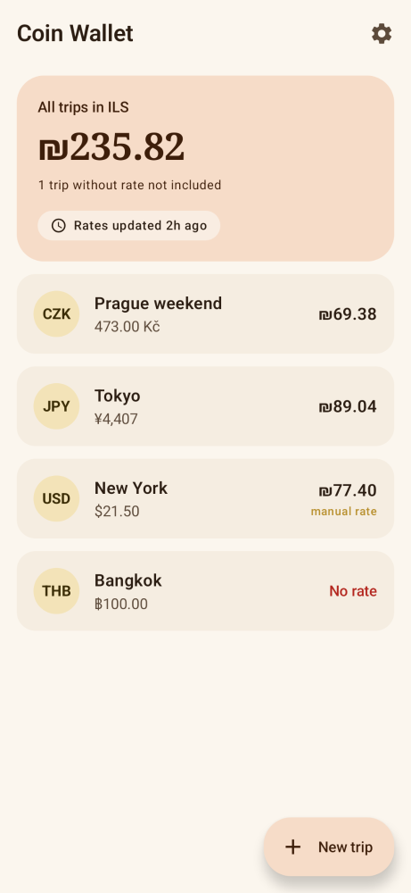
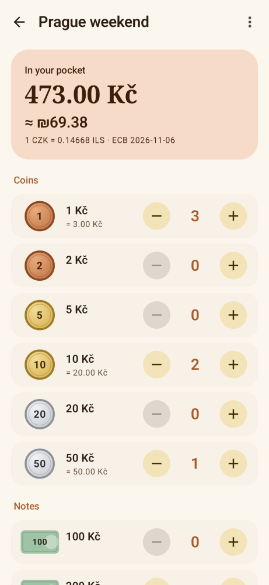
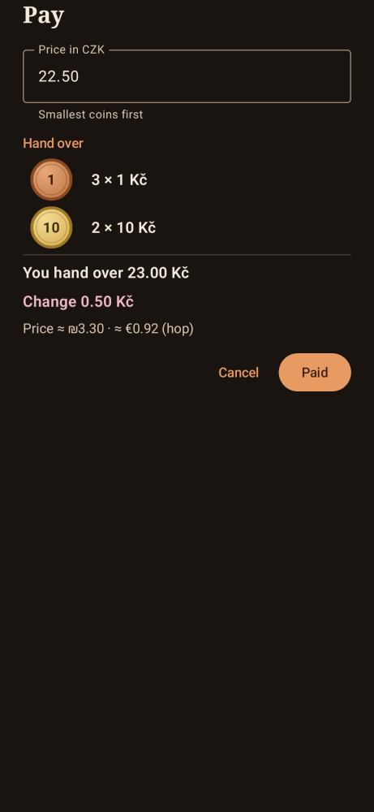
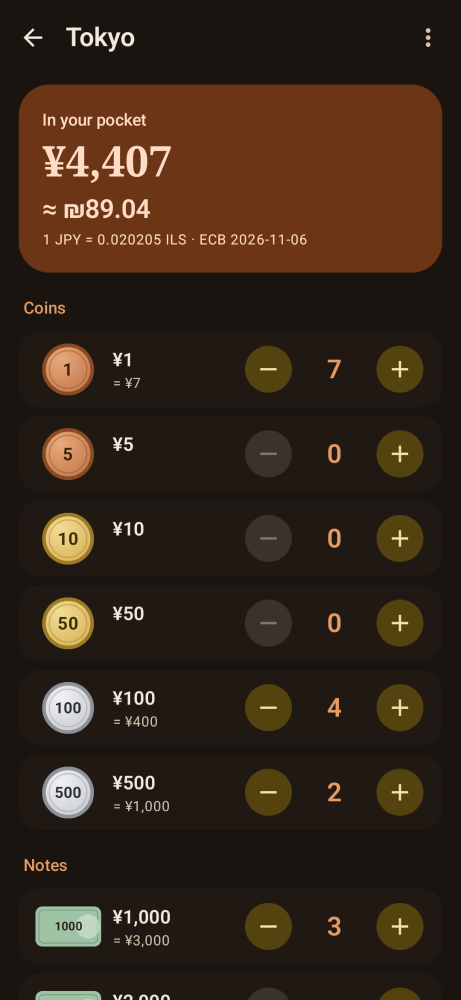
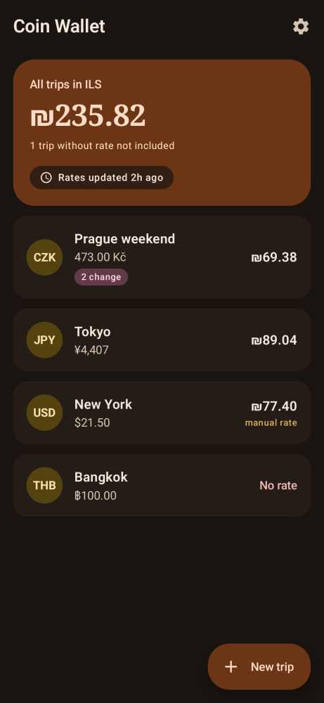
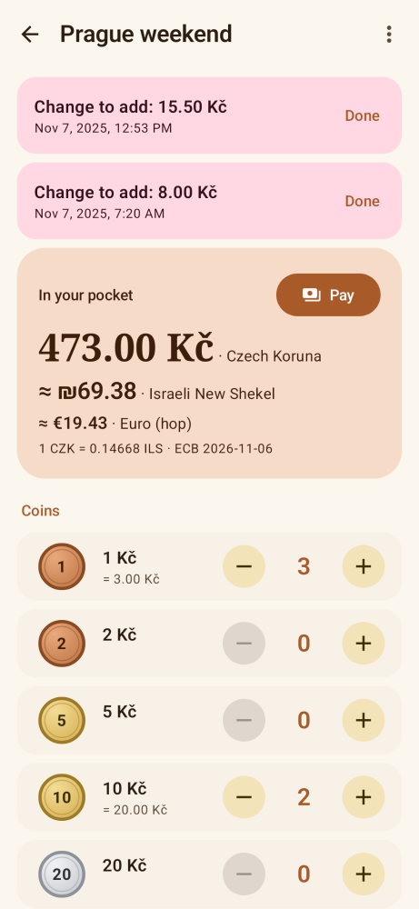
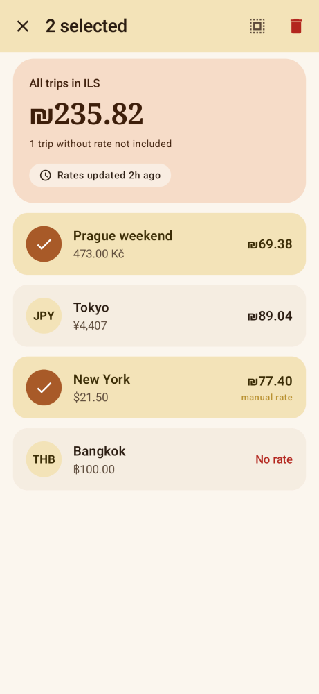
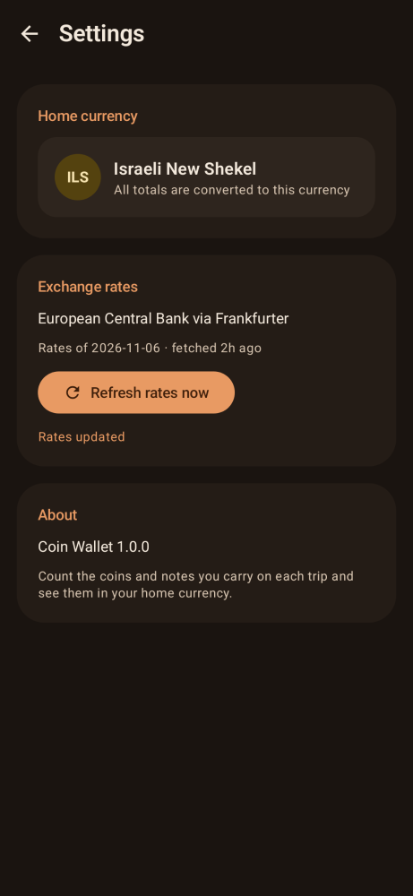

# Coin Wallet

Android app for travelers to track the foreign coins and notes in their pocket, and see what they're worth in their home currency.

**[⬇ Download the latest APK](https://github.com/IlanKog99/coin-wallet/releases/latest)**

<p>
  
  
  
  
</p>

## Features

- **Trips** – one wallet per trip, each in its own currency. Home screen shows each trip's value plus a grand total.
- **Count by denomination** – tap +/− on each coin and note. Built-in coin/note tables for ~30 currencies.
- **Home-currency conversion** – live ECB rates via [Frankfurter](https://frankfurter.dev), cached for offline use, with manual per-currency override.
- **Hop currency** – optional second currency shown on trip screens (toggle in Settings).
- **Pay** – enter an amount, get a suggestion that uses your smallest coins first. Tap Paid to deduct, or Cancel.
- **Change reminders** – overpay and the app keeps a dated reminder to add your change back, until you tap Done.
- **Quick cleanup** – swipe a trip to delete (with Undo), or long-press to multi-select.
- Light and dark themes, warm copper look.

<p>
  
  
  
  
</p>

## Install

1. On your Android phone (Android 11+), open the [latest release](https://github.com/IlanKog99/coin-wallet/releases/latest) and download the `.apk`.
2. Open it and allow "Install unknown apps" for your browser when asked.
3. Install and launch.

## Build

Requires JDK 17 and the Android SDK (API 35).

```bash
git clone https://github.com/IlanKog99/coin-wallet.git
cd coin-wallet
./gradlew testDebugUnitTest       # unit + Paparazzi snapshot tests
./gradlew assembleRelease         # APK in app/build/outputs/apk/release/
```

## Tech

Kotlin, Jetpack Compose (Material 3), ViewModel + StateFlow, kotlinx.serialization (local JSON storage), Paparazzi snapshot tests. minSdk 30, targetSdk 35.

Exchange rates: [Frankfurter API](https://frankfurter.dev), based on European Central Bank reference rates (updated each working day). No API key, no account, no tracking.
